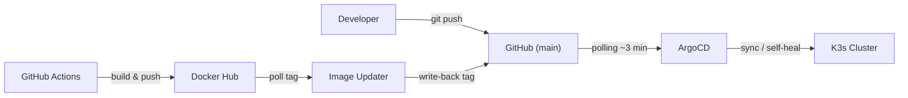

# K3s Dev Platform Lab

Laboratorio **local** basado en **K3s** para practicar **DevOps, GitOps e infraestructura cloud-native** en una sola máquina.

Incluye monitoreo, logging, calidad de código y despliegue automatizado de aplicaciones con **ArgoCD**. No es un entorno de dev ni de prod: prioriza que todo se levante rápido en local (credenciales simples, certificados autofirmados, un solo nodo).

---

## Objetivos del proyecto

- Construir un laboratorio funcional de Kubernetes ligero con **K3s**
- Implementar prácticas de **GitOps** (ArgoCD + Image Updater)
- Desplegar infraestructura base (observabilidad y CI/CD)
- Servir como entorno de pruebas para aplicaciones cloud-native
- Documentar una arquitectura realista para portafolio DevOps

---

## Arquitectura

```
k3s-lab/
├── .github/workflows/  # CI/CD (lint, trivy, sonar, build, rollback)
├── cluster/            # Instalación de K3s y addons base
├── infrastructure/     # ArgoCD, Image Updater, observabilidad, SonarQube
├── apps/               # Aplicaciones desplegadas en Kubernetes
├── argocd-apps/        # Applications de ArgoCD (GitOps)
├── scripts/            # Automatización (usada por el Makefile)
├── Makefile            # Punto de entrada: make help
└── docs/               # Documentación
```

Wiki visual con capturas y diagramas: [docs/wiki.md](docs/wiki.md). Detalle de componentes y arquitectura: [docs/architecture.md](docs/architecture.md).

---

## Stack tecnológico

- **Kubernetes (K3s)**, con Metrics Server integrado
- **ArgoCD** (GitOps) + **ArgoCD Image Updater** v1.x
- **Prometheus** (métricas) + **Grafana** (dashboards)
- **Loki + Promtail** (logs)
- **PostgreSQL 16** + **pgAdmin 4**, **MySQL 8.4 LTS** + **phpMyAdmin** (admins preconfigurados, sin datos de ejemplo)
- **SonarQube** LTS Community (análisis de código)
- **Trivy**, **KubeLinter**, **yamllint** (seguridad y linting)
- **GitHub Actions** (CI/CD)
- **NGINX Ingress Controller** (NodePort 31080/31443)
- **Cert-Manager** (ClusterIssuer autofirmado)

---

## Flujo GitOps

1. Los manifiestos viven en `apps/` e `infrastructure/`
2. Cada uno se registra como Application en `argocd-apps/`
3. **ArgoCD** consulta el repo (polling cada ~3 min) y detecta cambios
4. Sincroniza automáticamente el cluster (`prune` + `selfHeal`)

También se puede desplegar **sin GitHub**: `make push-local` envía tu working tree (sin commit) a un Git dentro del cluster y ArgoCD lee de ahí. Ver [Desplegar sin GitHub](#desplegar-sin-github).

Para la `sample-app`, además, **GitHub Actions** construye la imagen, **Image Updater** detecta el nuevo tag y hace commit del tag en `apps/sample-app/kustomization.yaml`, y ArgoCD lo despliega.



---

## Instalación rápida (recomendado)

Requisitos: Linux con `sudo` y `curl`, 4 GB de RAM mínimo (8 GB con SonarQube).

```bash
git clone https://github.com/zer0sh/k3s-lab.git
cd k3s-lab
make up                        # K3s (si falta) + addons + ArgoCD + infra + apps, y espera a que estén listas
make forward                   # port-forward a todos los servicios
eval "$(make env)"             # usar kubectl contra el lab en esta terminal
```

`make up` ejecuta `scripts/bootstrap.sh` (solo si K3s no está instalado) y `scripts/deploy-infra.sh`, y espera a que las 5 apps de ArgoCD estén `Synced`/`Healthy`. Se puede volver a ejecutar sin problema.

> El lab usa su propio kubeconfig (`~/.kube/config-k3s`) para no tocar `~/.kube/config` ni tus otros clusters. El Makefile y los scripts lo usan siempre, aunque tengas `KUBECONFIG` definido; se puede cambiar con la variable `K3S_KUBECONFIG`.

### Comandos `make`

| Comando                  | Descripción                                                                  |
|--------------------------|------------------------------------------------------------------------------|
| `make` / `make help`     | Lista todos los comandos                                                     |
| `make up`                | Levanta todo y espera a que las apps estén listas (`GIT_SOURCE=local`: sin GitHub) |
| `make bootstrap`         | Solo K3s + Ingress NGINX + Cert-Manager + ArgoCD (usa sudo)                  |
| `make infra`             | Solo observabilidad + Image Updater + registro de apps en ArgoCD             |
| `make wait`              | Espera a que las 5 apps estén `Synced`/`Healthy` (`TIMEOUT=900s`)            |
| `make status`            | Nodo, apps de ArgoCD y pods con problemas                                    |
| `make apps` / `make pods`| Applications + ImageUpdater / todos los pods                                 |
| `make forward`           | Port-forward a todos los servicios (`Ctrl+C` para detener)                   |
| `make password`          | Password de admin de ArgoCD                                                  |
| `make env`               | Imprime el `export KUBECONFIG=...` del lab                                   |
| `make git-creds GIT_USER=<usuario> GIT_TOKEN=<PAT>` | Crea el secret `argocd/git-creds` para Image Updater |
| `make db-creds`          | Usuarios y contraseñas actuales de las bases de datos                        |
| `make db-password TARGET=<t>` | Cambia una contraseña: `postgres`, `pgadmin`, `mysql`, `mysql-root`     |
| `make push-local`        | Envía el working tree (sin commit) al Git local y ArgoCD despliega desde ahí (`LOCAL_GIT=gitea\|light`) |
| `make local-git`         | Solo instala o cambia el Git local                                           |
| `make use-github`        | ArgoCD vuelve a leer de GitHub                                               |
| `make git-source`        | Fuente Git actual de ArgoCD y backend local                                  |
| `make refresh APP=<app>` | Fuerza a ArgoCD a releer Git para una app                                    |
| `make logs-image-updater`| Logs de Image Updater                                                        |
| `make lint`              | Valida YAML, Kustomize, scripts y workflows (sin cluster, usa Docker)        |
| `make down`              | Desinstala K3s y borra el kubeconfig del lab (pide confirmación)             |

Guía paso a paso (manual): [docs/installation-guide.md](docs/installation-guide.md).

---

## Acceso a servicios

```bash
make forward    # o: bash scripts/port-forward-all.sh
```

| Servicio   | Función            | Acceso local                   | Credenciales                |
|------------|--------------------|--------------------------------|-----------------------------|
| ArgoCD     | GitOps             | http://localhost:8080          | admin / (auto)              |
| Grafana    | Dashboards         | http://localhost:3000          | admin / admin               |
| Prometheus | Métricas           | http://localhost:9090          | -                           |
| SonarQube  | Análisis de código | http://localhost:9001          | admin / admin               |
| pgAdmin    | Admin PostgreSQL   | http://localhost:5050          | admin@devlab.com / admin123 |
| PostgreSQL | Base de datos      | localhost:5432                 | admin / admin123            |
| phpMyAdmin | Admin MySQL        | http://localhost:8082          | usuarios de MySQL           |
| MySQL      | Base de datos      | localhost:3306                 | admin / admin123, root / root123 |
| Sample App | App de ejemplo     | http://localhost:8081          | -                           |
| Loki       | Logs (API)         | http://localhost:3100/ready    | -                           |

Password de ArgoCD: `make forward` la imprime; también `make password` o `kubectl -n argocd get secret argocd-initial-admin-secret -o jsonpath="{.data.password}" | base64 -d`.

Son las credenciales iniciales. Si se cambian, `make db-creds` muestra las vigentes (ver [Bases de datos](#bases-de-datos)).

La `sample-app` también se expone por Ingress con TLS autofirmado en `https://sample-app.local:31443`. Detalle en [docs/access-services.md](docs/access-services.md).

---

## Desplegar sin GitHub

```bash
make push-local                    # working tree -> Git local (Gitea, con web) -> ArgoCD
make push-local LOCAL_GIT=light    # igual con el backend ligero (sin UI, ~15 MiB)
make up GIT_SOURCE=local           # levantar el lab entero sin pasar por GitHub
make use-github                    # volver a GitHub
```

El snapshot incluye cambios sin commitear y archivos nuevos, sin tocar tu rama ni tu índice. Hay otras formas (`argocd app sync --local`, OCI, `kubectl apply`); la comparación, los detalles y las limitaciones están en [docs/deploy-sin-github.md](docs/deploy-sin-github.md).

---

## Bases de datos

| Motor          | Namespace  | Admin preconfigurado                                      | UI                                          |
|----------------|------------|-----------------------------------------------------------|---------------------------------------------|
| PostgreSQL 16  | `postgres` | `admin` (superusuario) + base `devlab` vacía               | pgAdmin, con el servidor ya registrado      |
| MySQL 8.4 LTS  | `mysql`    | `admin` (todos los privilegios, `WITH GRANT OPTION`) y `root` + base `devlab` vacía | phpMyAdmin, apuntando a `mysql:3306` |

No se cargan datos de ejemplo. Las UIs no guardan contraseñas: piden la del usuario de la base de datos al conectar.

**Cambiar contraseñas**

```bash
make db-creds                          # muestra usuarios y contraseñas actuales
make db-password TARGET=postgres       # admin de PostgreSQL
make db-password TARGET=mysql          # admin de MySQL
make db-password TARGET=mysql-root     # root de MySQL
make db-password TARGET=pgadmin        # login web de pgAdmin (reinicia pgAdmin)
```

Pide la nueva contraseña dos veces; si la dejas vacía, genera una aleatoria de 24 caracteres y la muestra. Admite 8-64 caracteres: letras, números y `. _ @ % + = : , -`. Sin interacción: `NEW_PASSWORD=... bash scripts/db-password.sh <target>`.

El script cambia la contraseña en la base de datos y después en su `Secret`. Las Applications `postgres` y `mysql` ignoran los cambios en vivo de esos Secrets (`ignoreDifferences` + `RespectIgnoreDifferences`), así que ArgoCD no los revierte. Git solo guarda los valores iniciales: tras `make down` + `make up` vuelven los de la tabla de acceso.

---

## Scripts disponibles

El Makefile es una capa fina sobre estos scripts; se pueden usar directamente.

| Script                        | Descripción                                                                 |
|-------------------------------|-----------------------------------------------------------------------------|
| `scripts/bootstrap.sh`        | Instala K3s, Ingress NGINX, Cert-Manager (+ ClusterIssuer) y ArgoCD          |
| `scripts/deploy-infra.sh`     | Despliega monitoring, logging, Image Updater y registra las apps en ArgoCD  |
| `scripts/port-forward-all.sh` | Levanta port-forwards a todos los servicios (`Ctrl+C` para detener)         |
| `scripts/cleanup.sh`          | Desinstala K3s y borra `~/.kube/config-k3s`                                 |
| `scripts/db-password.sh`      | Muestra y cambia contraseñas de PostgreSQL, pgAdmin y MySQL                 |
| `scripts/local-git.sh`       | Git local en el cluster: instalar, enviar snapshot, cambiar la fuente de ArgoCD |
| `scripts/lib.sh`              | Funciones comunes (kubeconfig del lab, espera de CRDs y deployments)        |

---

## Configuración de GitHub (opcional)

Los workflows de lint, Trivy y build funcionan en runners de GitHub. **Rollback** y **SonarQube** necesitan alcanzar servicios que viven en el cluster local, así que requieren un [self-hosted runner](https://docs.github.com/actions/hosting-your-own-runners) en la máquina del lab. Sin sus secrets, esos workflows se saltan sin fallar.

**Secrets** (Settings > Secrets and variables > Actions):

| Secret               | Uso                          | Cómo obtenerlo                                                              |
|----------------------|------------------------------|-----------------------------------------------------------------------------|
| `DOCKERHUB_USERNAME` | Build & Push                 | Usuario de Docker Hub (`steven58380`)                                       |
| `DOCKERHUB_TOKEN`    | Build & Push                 | Docker Hub > Account Settings > Security > New Access Token                 |
| `SONAR_TOKEN`        | SonarQube                    | SonarQube > My Account > Security > Generate Token                          |
| `SONAR_HOST_URL`     | SonarQube                    | Desde el runner del lab: `http://localhost:9001` (con port-forward activo)  |
| `ARGOCD_AUTH_TOKEN`  | Rollback                     | `argocd login localhost:8080 --plaintext --username admin` y luego `argocd account generate-token --account ci` |
| `ARGOCD_SERVER`      | Rollback                     | Desde el runner del lab: `localhost:8080` (con port-forward activo)         |

**Variable** `CLUSTER_RUNNER`: label del self-hosted runner (p. ej. `self-hosted`). Si no existe, se usa `ubuntu-latest`.

**Secret en el cluster** (para que Image Updater haga commit del nuevo tag):

```bash
make git-creds GIT_USER=<usuario-github> GIT_TOKEN=<PAT con permiso de escritura en el repo>
```

---

## Limpieza

```bash
make down    # o: bash scripts/cleanup.sh
```

---

## Estructura detallada

### cluster/
- `bootstrap/install-k3s.sh`: instala K3s y copia el kubeconfig a `~/.kube/config-k3s`
- `addons/ingress-nginx/`: NGINX Ingress como Deployment + NodePort (31080/31443)
- `addons/cert-manager/`: Cert-Manager + `ClusterIssuer` `selfsigned-issuer`
- `addons/local-git/`: Git dentro del cluster (Gitea o ligero) para desplegar sin GitHub; lo instala `make push-local`
- `addons/metrics-server/`: **no se instala** (K3s ya trae Metrics Server). Solo útil si instalas K3s con `--disable metrics-server`

### infrastructure/
- `argocd/`: ArgoCD (HTTP, `server.insecure`) + cuenta `ci` para los workflows
- `argocd-image-updater/`: Image Updater v1.3 + CR `ImageUpdater` para la `sample-app`
- `monitoring/`: Prometheus + Grafana (datasources Prometheus y Loki, dashboard `K3s Platform Overview`)
- `logging/`: Loki + Promtail (`loki-stack`)
- `sonarqube/`: SonarQube + PostgreSQL 15 dedicado

### apps/
- `sample-app/`: nginx con página estática y `/health`. Kustomize (Namespace, ConfigMap, Deployment, Service, Ingress) + `docker/` con el Dockerfile
- `postgres/`: PostgreSQL 16 (StatefulSet + PVC 1Gi) + pgAdmin 4 (servidor preconfigurado vía `servers.json`)
- `mysql/`: MySQL 8.4 LTS (StatefulSet + PVC 1Gi, init que da privilegios globales al `admin`) + phpMyAdmin

### argocd-apps/
| Application      | Path                        | Gestiona                                                        |
|------------------|-----------------------------|-----------------------------------------------------------------|
| `infrastructure` | `infrastructure/` (recursivo) | Monitoring, logging, Image Updater (excluye `argocd/` y `sonarqube/`) |
| `sonarqube`      | `infrastructure/sonarqube`  | SonarQube + su base de datos                                    |
| `postgres`       | `apps/postgres`             | PostgreSQL + pgAdmin (ignora cambios en vivo del Secret)        |
| `mysql`          | `apps/mysql`                | MySQL + phpMyAdmin (ignora cambios en vivo del Secret)          |
| `sample-app`     | `apps/sample-app`           | App de ejemplo (Kustomize, actualizada por Image Updater)       |

---

## Limitaciones conocidas (es un lab)

- Credenciales iniciales en texto plano en los `Secret` del repo (pendiente: Sealed Secrets); se pueden cambiar en vivo con `make db-password`
- Certificados autofirmados; solo la `sample-app` tiene Ingress
- Sin alertas (Alertmanager deshabilitado) ni exporters específicos de apps
- Los linters y Trivy reportan en el Job Summary, pero no bloquean el pipeline
---

## Roadmap

Mejoras y funcionalidades planificadas para evolucionar el laboratorio:

- [ ] **Sealed Secrets**: Cifrado asimétrico de Secrets en Git con Bitnami Sealed Secrets
- [ ] **Autoscaling**: Horizontal Pod Autoscaler (HPA) basado en métricas para la `sample-app`
- [ ] **Seguridad de red**: Network Policies para aislar namespaces y restringir tráfico entre pods
- [ ] **Backups**: Velero para copias de seguridad de volúmenes y estado del cluster
- [ ] **Entornos**: Kustomize overlays para segmentar configuraciones (`dev` / `prod`)
- [ ] **Alertas y observabilidad avanzada**: Alertas en Alertmanager y exporters dedicados (Postgres, MySQL, NGINX)
- [ ] **Testing de infraestructura**: Smoke test automatizado en CI con k3d
