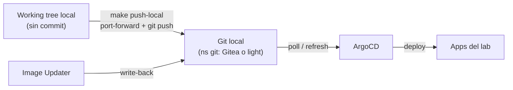
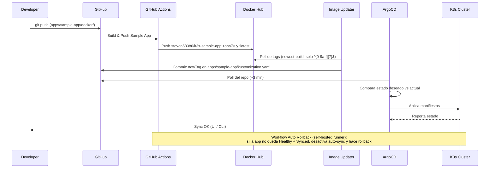
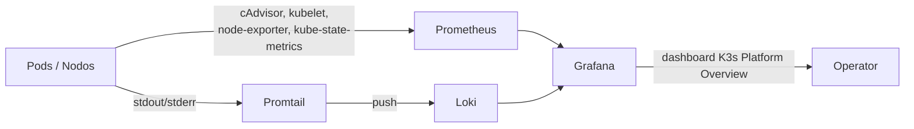
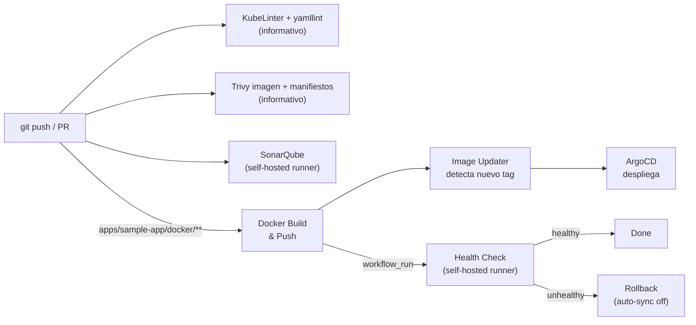

# Arquitectura - K3s Dev Platform Lab

Laboratorio local de un solo nodo. Los diagramas reflejan lo que está implementado en el repo.

## Diagrama general

```mermaid
flowchart TB
    Dev["Developer"]:::external
    GH["GitHub Repository"]:::external

    Dev -->|git push| GH

    subgraph K3s["K3s Cluster (un nodo)"]
        direction TB

        subgraph GitOps["GitOps (ns argocd)"]
            ArgoCD["ArgoCD\n(sync & deploy)"]
            IU["Image Updater\n(detecta nuevos tags)"]
        end

        GH -->|poll ~3 min| ArgoCD
        IU -->|commit del tag en\nkustomization.yaml| GH

        subgraph Apps["Applications"]
            SampleApp["sample-app\nKustomize: Deployment + Service\n+ Ingress + ConfigMap"]
            PG["PostgreSQL 16\n(StatefulSet + PVC)"]
            PGAdmin["pgAdmin 4\n(DB admin UI)"]
            MY["MySQL 8.4 LTS\n(StatefulSet + PVC)"]
            PMA["phpMyAdmin\n(DB admin UI)"]
        end

        subgraph Observability["Observability Stack"]
            Prometheus["Prometheus\n(+ kube-state-metrics,\nnode-exporter)"]
            Grafana["Grafana\n(dashboards)"]
            Loki["Loki\n(log aggregation)"]
            Promtail["Promtail\n(log collection)"]
        end

        subgraph QA["Code Quality"]
            SonarQube["SonarQube\n(static analysis)"]
            SonarDB["PostgreSQL 15\n(SonarQube DB)"]
            SonarQube --> SonarDB
        end

        subgraph Addons["Cluster Addons"]
            Ingress["NGINX Ingress\n(NodePort 31080/31443)"]
            CertMgr["Cert-Manager\n(selfsigned-issuer)"]
            MS["Metrics Server\n(integrado en K3s)"]
        end

        ArgoCD -->|deploy| Apps
        ArgoCD -->|deploy| Observability
        ArgoCD -->|deploy| QA
        ArgoCD -->|deploy| IU

        Promtail -->|logs| Loki
        Prometheus -->|scrape kubelet/cAdvisor,\nnodos, kube-state-metrics| K3s
        Grafana -->|query| Prometheus
        Grafana -->|query| Loki

        PGAdmin -->|manage| PG
        PMA -->|manage| MY

        CertMgr -->|certificado TLS| Ingress
        Ingress -->|route sample-app.local| SampleApp
    end

    DH["Docker Hub"]:::external
    CI["GitHub Actions\n(CI/CD)"]:::external

    GH -->|trigger| CI
    CI -->|push image| DH
    DH -->|poll ~2 min| IU

    User["User / Browser"]:::external
    User -->|HTTPS :31443| Ingress
    User -->|port-forward| K3s

    classDef external fill:#f0f0f0,stroke:#999,color:#333
```

### Fuente Git alternativa (sin GitHub)

`make push-local` instala un servidor Git en el namespace `git` (Gitea o `git-http-backend` ligero, ambos con la misma URL) y le envía un snapshot del working tree. Las Applications pasan a leer de `http://git.git.svc.cluster.local/lab/k3s-lab.git`, e Image Updater escribe ahí. `make use-github` las devuelve a GitHub. Detalle: [deploy-sin-github.md](deploy-sin-github.md).



## Flujo GitOps (sample-app)



## Flujo de observabilidad



Las apps no exponen métricas propias: los paneles muestran CPU, memoria, red, pods y reinicios por namespace, más los logs recientes de Loki. Alertmanager y Pushgateway están deshabilitados.

## Flujo CI/CD



## Componentes

### Capa de cluster (cluster/)
- **K3s**: distribución ligera de Kubernetes (v1.34+). Incluye Metrics Server, Traefik, CoreDNS y local-path-provisioner
- **NGINX Ingress**: controlador de tráfico entrante en NodePort 31080 (HTTP) / 31443 (HTTPS)
- **Cert-Manager**: emite certificados con el `ClusterIssuer` `selfsigned-issuer` (usado por el Ingress de la sample-app)

> **Nota:** K3s trae Traefik por defecto ocupando los puertos 80/443, por eso NGINX Ingress usa NodePort. Para usar puertos estándar, instala K3s con `--disable traefik`. El proyecto ingress-nginx fue retirado upstream: para un lab sirve, pero Traefik es la alternativa natural en K3s.

Todos los componentes Helm se instalan con el CRD `HelmChart` del helm-controller de K3s (namespace `kube-system`), sin necesidad de usar `helm` en la máquina.

### Capa de infraestructura (infrastructure/)
- **ArgoCD**: motor GitOps. Sirve HTTP (`server.insecure: true`). Cuenta `ci` (API key) con permisos `get`/`sync`/`update` sobre applications, para el workflow de rollback
- **ArgoCD Image Updater** v1.3: configurado con el CR `ImageUpdater` `sample-app`. Estrategia `newest-build` sobre tags `sha7` y write-back `git` a `kustomization.yaml`, con el secret `argocd/git-creds`
- **Prometheus**: chart `prometheus-community/prometheus`, retención 7d, PV 5Gi
- **Grafana**: datasources Prometheus y Loki preconfigurados; dashboard `K3s Platform Overview` cargado por sidecar desde un ConfigMap
- **Loki + Promtail**: chart `loki-stack`, PV 5Gi
- **SonarQube**: LTS Community con PostgreSQL 15 dedicado; initContainer privilegiado que ajusta `vm.max_map_count`

### Capa de aplicaciones (apps/)
- **sample-app**: nginx con página estática y endpoint `/health` (readiness/liveness). Imagen `steven58380/k3s-sample-app`, 2 réplicas
- **postgres**: PostgreSQL 16 (StatefulSet + PVC 1Gi, readiness `pg_isready`). Usuario `admin` superusuario y base `devlab` vacía. pgAdmin 4 con el servidor preconfigurado (`servers.json` desde un ConfigMap)
- **mysql**: MySQL 8.4 LTS (StatefulSet + PVC 1Gi, probes `mysqladmin ping`). Usuario `admin` con todos los privilegios (script de init en un ConfigMap), `root` y base `devlab` vacía. phpMyAdmin apuntando a `mysql:3306`
- Sin datos de ejemplo. Las contraseñas se cambian en vivo con `scripts/db-password.sh` (`make db-password`), que actualiza la base de datos y el Secret

### Applications de ArgoCD (argocd-apps/)

| Application      | Path                          | Notas                                                   |
|------------------|-------------------------------|---------------------------------------------------------|
| `infrastructure` | `infrastructure/` (recursivo) | Excluye `argocd/` (lo instala bootstrap) y `sonarqube/` |
| `sonarqube`      | `infrastructure/sonarqube`    |                                                         |
| `postgres`       | `apps/postgres`               | Ignora cambios en vivo de `postgres-secret`             |
| `mysql`          | `apps/mysql`                  | Ignora cambios en vivo de `mysql-secret`                |
| `sample-app`     | `apps/sample-app`             | Kustomize, requerido por Image Updater                  |

Todas usan sync automático con `prune` y `selfHeal`.

### Namespaces

| Namespace       | Componentes                                                        |
|-----------------|--------------------------------------------------------------------|
| `argocd`        | ArgoCD, Image Updater                                              |
| `monitoring`    | Prometheus (+ kube-state-metrics, node-exporter), Grafana          |
| `logging`       | Loki, Promtail                                                     |
| `sonarqube`     | SonarQube, PostgreSQL (SonarQube DB)                               |
| `postgres`      | PostgreSQL 16, pgAdmin 4                                           |
| `mysql`         | MySQL 8.4 LTS, phpMyAdmin                                          |
| `git`           | Git local (Gitea o ligero), solo con `make push-local`             |
| `sample-app`    | Sample App                                                         |
| `ingress-nginx` | NGINX Ingress Controller                                           |
| `cert-manager`  | Cert-Manager                                                       |
| `kube-system`   | CRs `HelmChart`, Traefik, Metrics Server, CoreDNS (propios de K3s) |

## Acceso

| Servicio   | Port-forward local          | Credenciales                |
|------------|-----------------------------|-----------------------------|
| ArgoCD     | http://localhost:8080       | admin / (auto)              |
| Grafana    | http://localhost:3000       | admin / admin               |
| Prometheus | http://localhost:9090       | -                           |
| SonarQube  | http://localhost:9001       | admin / admin               |
| pgAdmin    | http://localhost:5050       | admin@devlab.com / admin123 |
| Sample App | http://localhost:8081       | -                           |
| PostgreSQL | localhost:5432              | admin / admin123            |
| phpMyAdmin | http://localhost:8082       | usuarios de MySQL           |
| MySQL      | localhost:3306              | admin / admin123, root / root123 |
| Loki       | http://localhost:3100/ready | -                           |

Son las credenciales iniciales (`make db-creds` muestra las vigentes). Detalle en [access-services.md](access-services.md).
