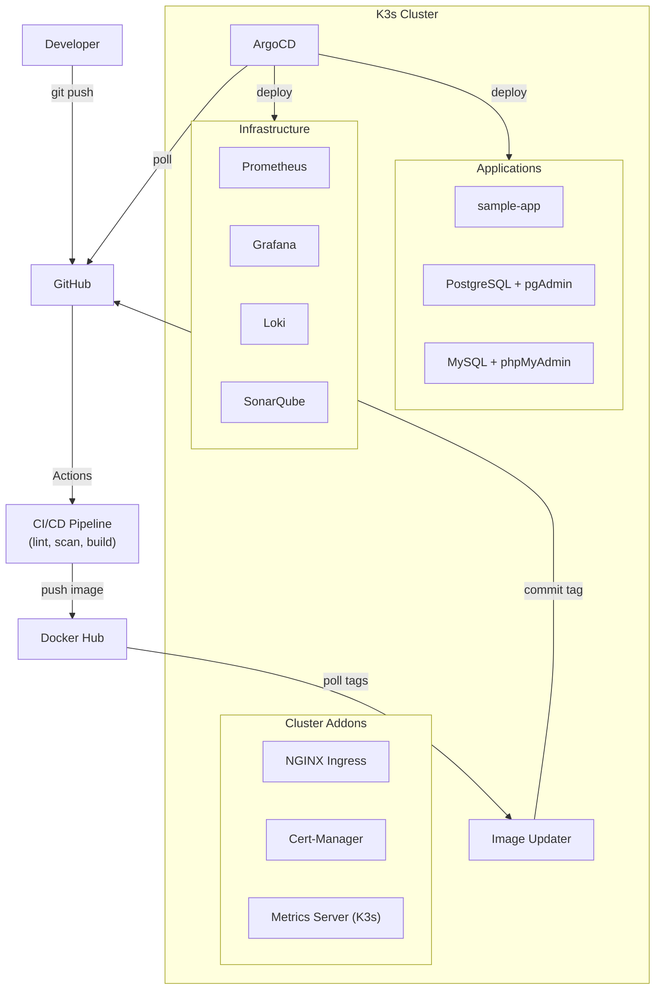

# K3s Dev Platform Lab — Portfolio

> Laboratorio cloud-native local que demuestra prácticas de DevOps, GitOps, CI/CD, observabilidad y seguridad sobre Kubernetes.

---

## ¿Qué es este proyecto?

Un laboratorio de infraestructura construido desde cero sobre **K3s** (Kubernetes ligero), que se levanta en una sola máquina con dos comandos. Incluye despliegue GitOps, actualización automática de imágenes, monitoreo, logging, escaneo de seguridad y rollback.

Está pensado como entorno de práctica local, no como réplica de dev o prod: prioriza la simplicidad (un nodo, certificados autofirmados, credenciales de lab).

---

## Stack completo

| Capa          | Tecnología                         | Función                                                  |
|---------------|------------------------------------|----------------------------------------------------------|
| Orquestación  | K3s (Kubernetes)                   | Cluster ligero de un nodo                                |
| GitOps        | ArgoCD + Image Updater v1.x        | Despliegue automático desde Git                          |
| CI/CD         | GitHub Actions                     | Lint, scan, análisis, build, rollback                    |
| Monitoring    | Prometheus                         | Métricas de nodos, pods y objetos del cluster            |
| Dashboards    | Grafana                            | Visualización de métricas y logs                         |
| Logging       | Loki + Promtail                    | Agregación centralizada de logs                          |
| Base de datos | PostgreSQL 16, MySQL 8.4 LTS       | StatefulSets con persistencia y admins preconfigurados   |
| DB Admin      | pgAdmin 4, phpMyAdmin              | Gestión visual, con el servidor ya configurado           |
| Ingress       | NGINX Ingress Controller           | Enrutamiento de tráfico (NodePort 31080/31443)           |
| TLS           | Cert-Manager                       | Certificados con ClusterIssuer autofirmado               |
| Seguridad     | Trivy                              | Escaneo de vulnerabilidades (imagen + manifiestos)       |
| Calidad       | SonarQube (LTS Community)          | Análisis estático de código (con PostgreSQL dedicado)    |
| Linting       | KubeLinter + yamllint              | Revisión de manifiestos K8s y sintaxis YAML              |

---

## Capacidades demostradas

### GitOps con ArgoCD

ArgoCD sincroniza automáticamente el estado del cluster con el repositorio. Cualquier cambio en `apps/` o `infrastructure/` se detecta (polling) y se despliega sin intervención manual.

<!-- screenshot: argocd-dashboard.png -->

**Funcionalidades:**
- Sync automático con self-heal (si alguien modifica algo en el cluster, ArgoCD lo revierte)
- Prune automático (si se elimina un recurso del repo, se elimina del cluster)
- Image Updater v1.x configurado con el CRD `ImageUpdater`: detecta nuevos tags en Docker Hub y hace commit del tag en `kustomization.yaml` (write-back a Git)
- Fuente Git intercambiable: GitHub o un Git dentro del cluster (Gitea o `git-http-backend`). `make push-local` despliega el working tree sin commit ni push
- Cinco Applications gestionadas: `sample-app`, `postgres`, `mysql`, `sonarqube` e `infrastructure`
- `ignoreDifferences` en los Secrets de las bases de datos: las contraseñas se cambian en vivo sin que el self-heal las revierta

### Pipeline CI/CD

<!-- screenshot: github-actions-overview.png -->

```
push a main
    |
    v
+-------------------+     +------------------+     +------------------+
| Lint Manifests    |     | Trivy Security   |     | SonarQube        |
| (KubeLinter +     |     | (Image scan +    |     | (Code quality    |
|  yamllint)        |     |  Config scan)    |     |  analysis)       |
+-------------------+     +------------------+     +------------------+
    |
    v  (cambios en apps/sample-app/docker/)
+-------------------+
| Build & Push      |
| (Docker Hub)      |
+-------------------+
    |
    v
+-------------------+
| Image Updater     |
| commit del tag -> |
| ArgoCD despliega  |
+-------------------+
    |
    v
+-------------------+
| Health Check      |---> OK: done
| (post-deploy)     |---> FAIL: rollback
+-------------------+
```

**Workflows:**

| Workflow        | Qué hace                                                        | Trigger                                              | Runner          |
|-----------------|-----------------------------------------------------------------|------------------------------------------------------|-----------------|
| Build & Push    | Construye la imagen y la sube a Docker Hub (`<sha7>` y `latest`) | Push a `apps/sample-app/docker/`                     | GitHub          |
| Lint Manifests  | KubeLinter y yamllint, con reporte en el Job Summary            | Push/PR que modifica YAML                            | GitHub          |
| Trivy Scan      | Vulnerabilidades en la imagen y misconfiguraciones en manifiestos | Push/PR que modifica Dockerfiles o manifiestos     | GitHub          |
| SonarQube       | Análisis estático contra el SonarQube del lab                   | Push/PR a main                                       | Self-hosted     |
| Auto Rollback   | Health check post-deploy y rollback si falla                    | Después del build, o manual                          | Self-hosted     |

Todos generan **GitHub Job Summaries** con tablas, conteos y secciones colapsables. Lint y Trivy son informativos: reportan pero no bloquean. SonarQube y Rollback necesitan un self-hosted runner en la máquina del lab, porque el cluster no es público; sin sus secrets se saltan sin fallar.

<!-- screenshot: github-summary-trivy.png -->

### Observabilidad

<!-- screenshot: grafana-dashboard.png -->

**Prometheus** recolecta métricas de nodos (node-exporter), contenedores (cAdvisor/kubelet) y objetos del cluster (kube-state-metrics). **Grafana** las muestra en el dashboard preconfigurado **K3s Platform Overview**: CPU y memoria por namespace, pods, reinicios, red y logs recientes. **Loki** + **Promtail** agregan los logs de todos los contenedores para búsqueda centralizada.

| Servicio   | Puerto local | Credenciales                |
|------------|--------------|-----------------------------|
| ArgoCD     | :8080        | admin / (auto)              |
| Grafana    | :3000        | admin / admin               |
| Prometheus | :9090        | -                           |
| SonarQube  | :9001        | admin / admin               |
| pgAdmin    | :5050        | admin@devlab.com / admin123 |
| PostgreSQL | :5432        | admin / admin123            |
| phpMyAdmin | :8082        | usuarios de MySQL           |
| MySQL      | :3306        | admin / admin123, root / root123 |
| Sample App | :8081        | -                           |
| Loki       | :3100        | -                           |

<!-- screenshot: prometheus-targets.png -->

### Bases de datos con persistencia

**PostgreSQL 16** y **MySQL 8.4 LTS** desplegados como **StatefulSet** con PersistentVolumeClaim, demostrando manejo de estado en Kubernetes. Cada motor tiene su UI de administración: **pgAdmin 4** y **phpMyAdmin**.

<!-- screenshot: pgadmin-dashboard.png -->

**Características:**
- StatefulSet (no Deployment), el patrón correcto para bases de datos
- PVC de 1Gi con ReadWriteOnce
- Readiness probe con `pg_isready` / `mysqladmin ping`
- Admins preconfigurados sin datos de ejemplo: `admin` superusuario en PostgreSQL; `admin` con todos los privilegios (script de init) y `root` en MySQL
- pgAdmin con el servidor registrado (`servers.json`) y phpMyAdmin apuntando a MySQL
- Cambio de contraseñas con `make db-password`: actualiza la base de datos y el `Secret`, sin exponer la contraseña en los argumentos de los procesos
- Credenciales en un `Secret` referenciado con `secretKeyRef`. Los valores iniciales están en texto plano en el repo; Sealed Secrets está en el roadmap

### Seguridad y calidad de código

**Trivy** escanea en dos niveles:
- **Imagen Docker**: detecta CVEs en dependencias y en el OS base
- **Manifiestos Kubernetes**: detecta misconfiguraciones (containers como root, sin limits, etc.)

<!-- screenshot: trivy-scan-results.png -->

**SonarQube** (LTS Community) se despliega dentro del cluster con su propia base de datos PostgreSQL. Analiza calidad de código y detecta bugs, code smells y vulnerabilidades. Accesible en http://localhost:9001.

<!-- screenshot: sonarqube-dashboard.png -->

### Rollback automático

Si un deploy deja la app en estado unhealthy, el workflow de rollback:

1. Espera el sync y consulta el estado de la app con el CLI de ArgoCD (cuenta `ci` con permisos mínimos)
2. Si no está Healthy + Synced, obtiene la revisión anterior del historial de ArgoCD
3. Desactiva el auto-sync (ArgoCD no permite rollback con auto-sync activo) y ejecuta `argocd app rollback`
4. Genera un summary con los detalles e indica cómo reactivar el auto-sync tras corregir

<!-- screenshot: rollback-summary.png -->

También se puede ejecutar manualmente desde GitHub Actions, seleccionando la app.

### Automatización con scripts

Todo el entorno se levanta con un comando, que espera a que las apps estén `Synced`/`Healthy`:

```bash
make up         # K3s + addons + ArgoCD + observabilidad + Image Updater + apps
make forward    # acceso local a todos los servicios
```

El `Makefile` también cubre estado (`make status`), credenciales (`make password`, `make git-creds`), validación sin cluster (`make lint`) y limpieza (`make down`). Por debajo usa estos scripts:

| Script                | Función                                                                              |
|-----------------------|--------------------------------------------------------------------------------------|
| `bootstrap.sh`        | Instala K3s, configura `~/.kube/config-k3s`, despliega addons y ArgoCD (esperando CRDs) |
| `deploy-infra.sh`     | Despliega monitoring, logging e Image Updater, y registra las apps en ArgoCD          |
| `port-forward-all.sh` | Expone todos los servicios localmente con un solo comando                            |
| `local-git.sh`        | Git en el cluster como fuente de ArgoCD (despliegue sin GitHub)                      |
| `cleanup.sh`          | Desinstala K3s y borra el kubeconfig del lab                                         |

---

## Arquitectura



Diagramas detallados: [docs/architecture.md](architecture.md)

---

## Estructura del repositorio

```
k3s-lab/
├── .github/workflows/       # CI/CD pipelines
│   ├── build-sample-app.yaml
│   ├── lint-manifests.yaml
│   ├── trivy-scan.yaml
│   ├── sonarqube.yaml
│   └── rollback.yaml
├── apps/                    # Aplicaciones
│   ├── sample-app/          # Kustomize + docker/ (Dockerfile)
│   ├── postgres/            # PostgreSQL + pgAdmin
│   └── mysql/               # MySQL + phpMyAdmin
├── argocd-apps/             # Applications de ArgoCD
│   ├── sample-app.yaml
│   ├── postgres.yaml
│   ├── mysql.yaml
│   ├── sonarqube.yaml
│   └── infrastructure.yaml
├── cluster/                 # Bootstrap y addons
│   ├── bootstrap/
│   └── addons/
├── infrastructure/          # Servicios de plataforma
│   ├── argocd/
│   ├── argocd-image-updater/
│   ├── monitoring/
│   ├── logging/
│   └── sonarqube/
├── scripts/                 # Automatización
├── docs/                    # Documentación (incl. deploy-sin-github.md)
├── AGENTS.md                # Guía para agentes de IA
├── Makefile                 # Punto de entrada: make help
└── sonar-project.properties
```

---

## Screenshots

> Las capturas se agregarán próximamente.

| Captura                              | Descripción                                        |
|--------------------------------------|----------------------------------------------------|
| <!-- argocd-dashboard.png -->        | Dashboard de ArgoCD con las apps desplegadas       |
| <!-- github-actions-overview.png --> | Vista general de GitHub Actions con los workflows  |
| <!-- github-summary-trivy.png -->    | Job Summary de Trivy con resultados del escaneo    |
| <!-- grafana-dashboard.png -->       | Dashboard de Grafana con métricas del cluster      |
| <!-- prometheus-targets.png -->      | Targets de Prometheus mostrando los endpoints      |
| <!-- pgadmin-dashboard.png -->       | pgAdmin conectado a PostgreSQL                     |
| <!-- sonarqube-dashboard.png -->     | Dashboard de SonarQube con análisis del proyecto   |
| <!-- trivy-scan-results.png -->      | Resultados detallados del escaneo de Trivy         |
| <!-- rollback-summary.png -->        | Job Summary del rollback automático                |

---

## Tecnologías y herramientas


