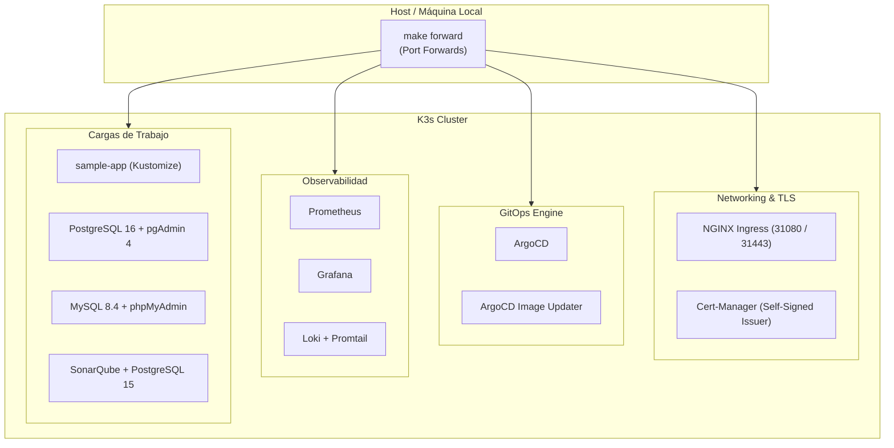
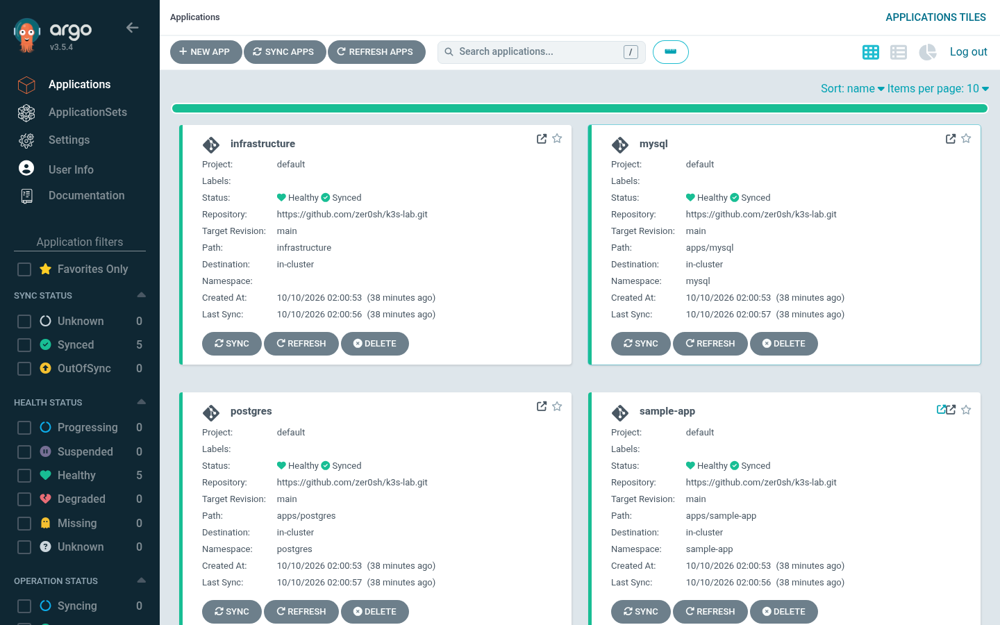
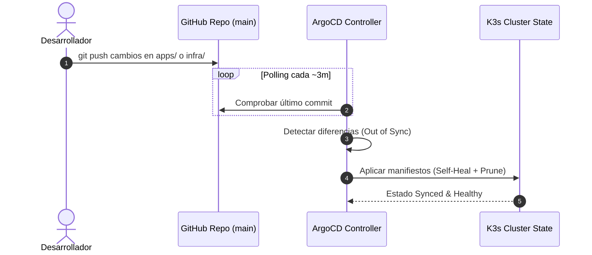
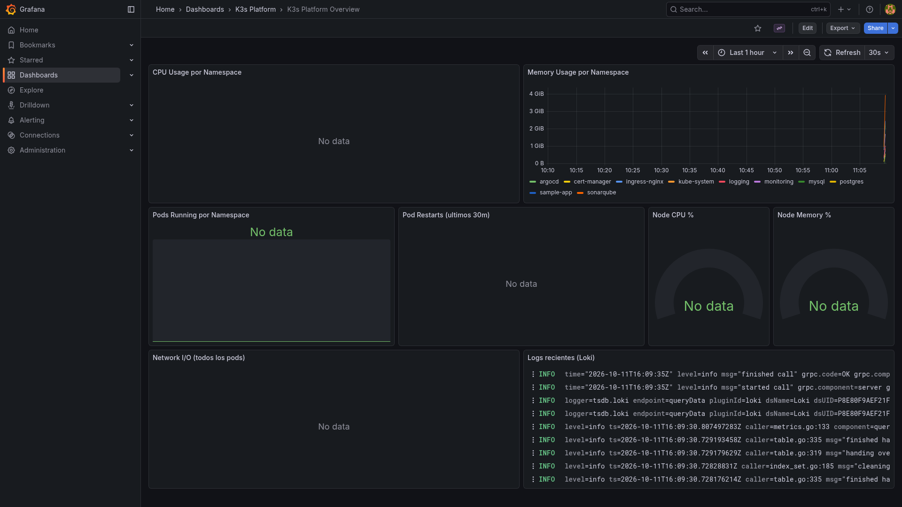
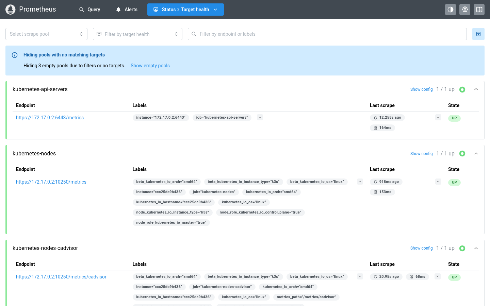
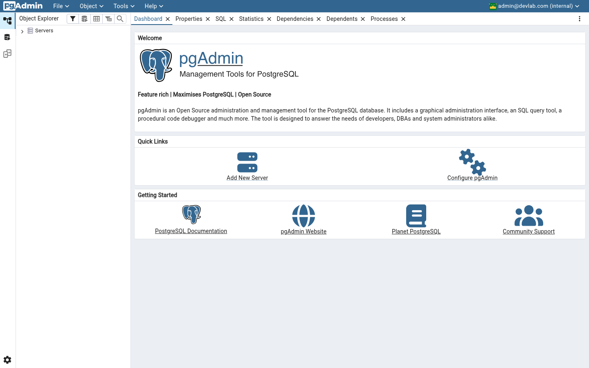
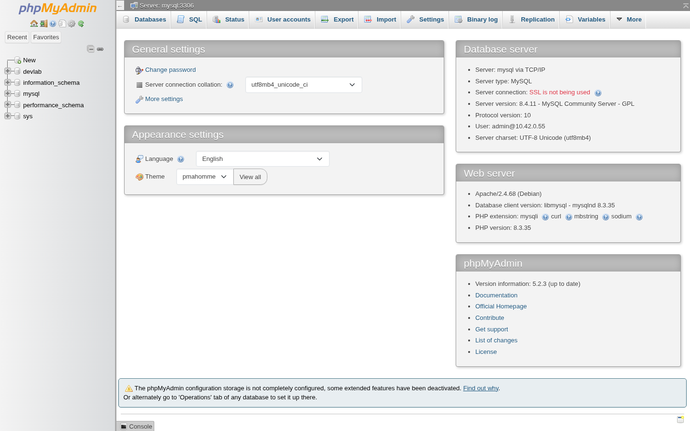
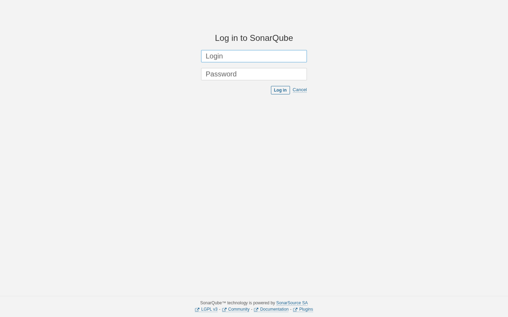
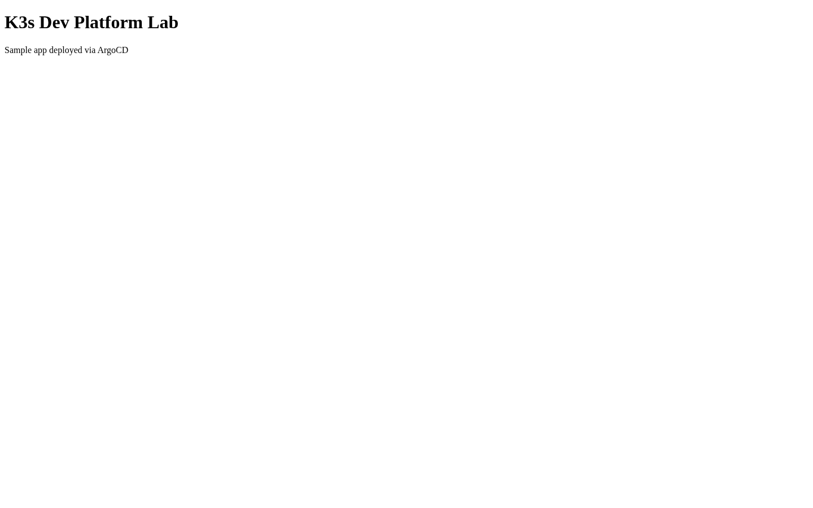
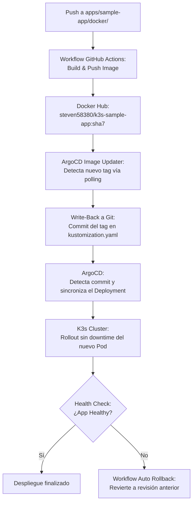

# 📖 Wiki del Laboratorio — K3s Dev Platform Lab

Bienvenido a la Wiki técnica del laboratorio **K3s Dev Platform**. Esta guía sirve como referencia central y catálogo visual de todos los servicios, herramientas de observabilidad, bases de datos y flujos GitOps desplegados en el clúster.

---

## 📑 Tabla de Contenidos

1. [Visión General del Clúster](#1-visión-general-del-clúster)
2. [GitOps con ArgoCD](#2-gitops-con-argocd)
3. [Dashboards y Métricas con Grafana](#3-dashboards-y-métricas-con-grafana)
4. [Monitoreo y Targets con Prometheus](#4-monitoreo-y-targets-con-prometheus)
5. [Gestión de Bases de Datos con pgAdmin (PostgreSQL)](#5-gestión-de-bases-de-datos-con-pgadmin-postgresql)
6. [Gestión de Bases de Datos con phpMyAdmin (MySQL)](#6-gestión-de-bases-de-datos-con-phpmyadmin-mysql)
7. [Análisis de Calidad de Código con SonarQube](#7-análisis-de-calidad-de-código-con-sonarqube)
8. [Aplicación Demo (sample-app) e Ingress TLS](#8-aplicación-demo-sample-app-e-ingress-tls)
9. [Flujo CI/CD y Automatización](#9-flujo-cicd-y-automatización)
10. [Tabla Resumen de Accesos y Credenciales](#10-tabla-resumen-de-accesos-y-credenciales)

---

## 1. Visión General del Clúster

El laboratorio está orquestado sobre **K3s** (Kubernetes ligero), diseñado para operar localmente con el menor consumo de recursos posible, pero implementando patrones reales de producción: GitOps, Ingress Controller con TLS automatizado, observabilidad completa (métricas, logs, dashboards) y bases de datos con volúmenes persistentes.



---

## 2. GitOps con ArgoCD

**ArgoCD** actúa como la única fuente de verdad operativa (*Single Source of Truth*). Implementa reconciliación continua mediante *polling* a la rama `main` del repositorio.

- **URL de acceso:** [http://localhost:8080](http://localhost:8080)
- **Usuario:** `admin`
- **Contraseña:** Obtener con `make password` (o secret `argocd-initial-admin-secret`)
- **Applications sincronizadas:**
  1. `infrastructure`: Monitoreo (Prometheus, Grafana), logging (Loki, Promtail) e Image Updater.
  2. `postgres`: PostgreSQL 16 StatefulSet y pgAdmin 4.
  3. `mysql`: MySQL 8.4 LTS StatefulSet y phpMyAdmin.
  4. `sonarqube`: SonarQube LTS Community y su base de datos PostgreSQL 15.
  5. `sample-app`: Aplicación web Kustomize con probes de salud y TLS.

### Dashboard de ArgoCD con las 5 Aplicaciones Healthy




---

## 3. Dashboards y Métricas con Grafana

**Grafana** centraliza la visualización de métricas del clúster y registros de logs. Viene preconfigurado con:
- Data source **Prometheus** (métricas).
- Data source **Loki** (logs en tiempo real).
- Dashboard integrado **K3s Platform Overview** que muestra métricas de CPU, memoria, reinicios de pods y consumo de red.

- **URL de acceso:** [http://localhost:3000](http://localhost:3000)
- **Dashboard directo:** [http://localhost:3000/d/k3s-platform-overview/k3s-platform-overview](http://localhost:3000/d/k3s-platform-overview/k3s-platform-overview)
- **Credenciales:** `admin` / `admin`

### Dashboard K3s Platform Overview en Ejecución


Paneles principales:
- **CPU & Memory Usage por Namespace:** Consumo desglosado mediante métricas de cAdvisor.
- **Pods Running por Namespace:** Contador activo de pods en estado saludable.
- **Pod Restarts (últimos 30m):** Tabla de eventos de reinicio de contenedores para auditoría rápida.
- **Node CPU % y Node Memory %:** Gauges en tiempo real provistos por `node-exporter`.
- **Network I/O:** Tráfico de red transmitido y recibido por los pods.

---

## 4. Monitoreo y Targets con Prometheus

**Prometheus** realiza el *scraping* de los componentes internos de Kubernetes y los exportadores de métricas del sistema.

- **URL de acceso:** [http://localhost:9090](http://localhost:9090)
- **Página de Targets:** [http://localhost:9090/targets](http://localhost:9090/targets)

### Vista de Targets de Prometheus


Targets monitoreados:
- `kubernetes-nodes-cadvisor`: Métricas de rendimiento de contenedores (CPU, memoria, filesystem).
- `kubernetes-service-endpoints`: `kube-state-metrics` (estado de pods, deployments, réplicas).
- `node-exporter`: Métricas del sistema operativo anfitrión (CPU idle, memoria disponible, I/O).

---

## 5. Gestión de Bases de Datos con pgAdmin (PostgreSQL)

El entorno incluye una instancia de **PostgreSQL 16** gestionada como `StatefulSet` con volumen persistente (`1Gi`), acompañada por **pgAdmin 4** con el servidor ya registrado automáticamente mediante un ConfigMap (`servers.json`).

- **URL de acceso:** [http://localhost:5050](http://localhost:5050)
- **Usuario pgAdmin:** `admin@devlab.com`
- **Contraseña pgAdmin:** `admin123`
- **Conexión a BD:** Host `postgres:5432`, base `devlab`, usuario `admin`, contraseña `admin123`.

### Interfaz Web de pgAdmin Conectada


> **Nota:** Las contraseñas iniciales pueden modificarse en caliente en la base de datos y en el Secret mediante el comando `make db-password TARGET=postgres|pgadmin`. Gracias a la configuración de `ignoreDifferences` en ArgoCD, el cambio no es revertido por el *self-heal*.

---

## 6. Gestión de Bases de Datos con phpMyAdmin (MySQL)

Se despliega un servidor **MySQL 8.4 LTS** junto con **phpMyAdmin** para la administración visual de bases de datos relacionales MySQL. El usuario `admin` cuenta con privilegios globales preconfigurados en el arranque mediante `configmap-initdb.yaml`.

- **URL de acceso:** [http://localhost:8082](http://localhost:8082)
- **Usuarios disponibles:**
  - `admin` / `admin123`
  - `root` / `root123`
- **Servicio interno:** `mysql.mysql.svc.cluster.local:3306`

### Interfaz Web de phpMyAdmin Conectada


---

## 7. Análisis de Calidad de Código con SonarQube

Para la inspección continua de calidad y deuda técnica, el clúster incorpora **SonarQube Community LTS** respaldado por su propia base de datos dedicada **PostgreSQL 15**.

- **URL de acceso:** [http://localhost:9001](http://localhost:9001)
- **Credenciales:** `admin` / `admin`

### Interfaz Web de SonarQube


---

## 8. Aplicación Demo (sample-app) e Ingress TLS

La `sample-app` es una aplicación web empaquetada con **Kustomize** que sirve como banco de pruebas para el ciclo de entrega continua y enrutamiento con certificados TLS automáticos.

- **Acceso por Port-Forward:** [http://localhost:8081](http://localhost:8081)
- **Acceso Ingress TLS:** `https://sample-app.local:31443` (certificado autofirmado emitido por `cert-manager`).
- **Endpoint de salud:** `/health` (utilizado por las sondas *Liveness* y *Readiness*).

### Interfaz Web de la Sample App


---

## 9. Flujo CI/CD y Automatización

El ciclo de integración y despliegue continuo vincula **GitHub Actions**, **Docker Hub**, **ArgoCD Image Updater** y **ArgoCD**:



---

## 10. Tabla Resumen de Accesos y Credenciales

Todos los servicios locales se exponen de forma centralizada ejecutando en la terminal:
```bash
make forward
```

| Servicio | URL Local | Usuario | Contraseña / Token | Función |
| :--- | :--- | :--- | :--- | :--- |
| **ArgoCD** | `http://localhost:8080` | `admin` | `make password` | Control GitOps y despliegue de aplicaciones |
| **Grafana** | `http://localhost:3000` | `admin` | `admin` | Dashboards de métricas y visualización de logs |
| **Prometheus** | `http://localhost:9090` | *(Sin auth)* | *(Sin auth)* | Recolección de métricas y evaluación de queries |
| **Sample App** | `http://localhost:8081` | *(Público)* | *(Público)* | Aplicación web de prueba |
| **pgAdmin** | `http://localhost:5050` | `admin@devlab.com` | `admin123` | Administrador visual de PostgreSQL |
| **phpMyAdmin** | `http://localhost:8082` | `admin` / `root` | `admin123` / `root123` | Administrador visual de MySQL |
| **SonarQube** | `http://localhost:9001` | `admin` | `admin` | Análisis de calidad de código y bugs |
| **Loki** | `http://localhost:3100/ready`| *(Interno)* | *(Interno)* | Endpoint de salud de agregación de logs |
| **Git local** | `http://localhost:3030` | `lab` | `labgit123` | Servidor Git in-cluster (solo con backend Gitea) |
